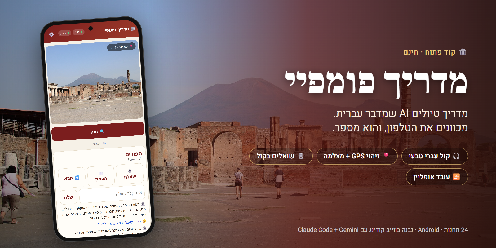
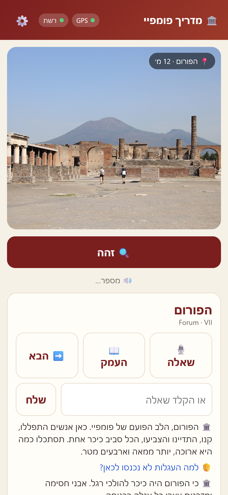

<div dir="rtl">



# 🏛️ מדריך פומפיי — מדריך טיולים AI שמדבר עברית

**חינם · קוד פתוח · נבנה בווייב-קודינג**

מכוונים את הטלפון לאתר, לוחצים **זהה**, והמדריך מספר בעברית מה רואים, מה קרה שם ומה כדאי לחפש.
אפשר לעצור אותו באמצע ולשאול שאלה בקול, כמו מדריך אמיתי.



## מה יש בפנים

- 📍 **24 תחנות** (+2 אופציונליות) לאורך מסלול של חצי יום בפומפיי, כל אחת עם תסריט עברי שנחקר ונבדק
- 🔍 **זיהוי אוטומטי**: GPS עם שובר-שוויון לפי המסלול, ואם רוצים גם זיהוי מתמונת המצלמה
- 🗣️ **קול עברי טבעי** (Gemini TTS), עם צחוקים, אנחות והפסקות במקומות הנכונים
- 🎙️ **שאלות בקול** עם קטיעה (barge-in): מתחילים לדבר והמדריך עוצר ומקשיב
- 📖 **"העמק"** למי שרוצה עוד, **"הבא"** לניווט לתחנה הבאה
- 📴 **עובד גם בלי רשת**: הסיפור הבסיסי עובד אופליין, ורק השאלות החופשיות צריכות אינטרנט
- 🔑 **בלי שרת**: כל משתמש מכניס את המפתח שלו בהגדרות, והוא נשמר רק בטלפון

<br clear="left">

## איך מריצים

```bash
git clone https://github.com/noamsolomon123/pompeii-guide.git
cd pompeii-guide
npm install
npm run serve            # http://localhost:8080/www/
```

**APK לאנדרואיד:** כל push ל-`main` בונה APK ב-GitHub Actions (לשונית Actions ← `pompeii-guide-debug-apk`).
בנייה מקומית: `npx cap sync android && npm run apk:debug`.

**מפתחות:** ⚙️ בתוך האפליקציה. צריך אחד מהם: Gemini (Gemini Live), OpenRouter (Whisper → LLM → TTS) או OpenAI (Realtime).

## איך זה בנוי

| תיקייה | מה יש שם |
|---|---|
| `content/stops/*.json` | התסריטים העבריים לכל תחנה: פתיחה, העמקה, מה לחפש, שאלות נפוצות, אנקדוטות ומקורות |
| `content/research/` | המחקר שמאחורי כל תחנה |
| `scripts/build-stops.mjs` | בדיקת התוכן ובנייה ל-`www/stops.json` |
| `www/` | האפליקציה: JS נקי, בלי פריימוורק |
| `android/` | מעטפת Capacitor ל-APK |
| `scripts/sim/` | סימולציה מלאה של הסיור באמולטור עם GPS מזויף |

```bash
npm test                 # 93 טסטים
npm run check:stops      # בדיקת תקינות התוכן
```

## רוצים מדריך לאתר אחר?

זה הרעיון הבא. רומא, פטרה, עיר דוד, מה שבא לכם.
כל התוכן יושב ב-`content/stops/` בפורמט אחיד, אז אתר חדש זה בעיקר תחקיר ותסריטים.
פתחו Issue או PR 🙌

## סטטוס

גרסה ראשונה. נבדקה בסימולציה (24/24 תחנות זוהו), והבדיקה בשטח בפומפיי היא באוקטובר 2026.
הקולות המוקלטים מראש עדיין לא נוצרו, ועד אז האפליקציה משתמשת בקול המובנה של אנדרואיד.

## קרדיטים

- נבנה עם [Claude Code](https://claude.com/claude-code) ו-Gemini
- צילום הפורום עם הווזוב: Gary Todd, [Wikimedia Commons](https://commons.wikimedia.org/wiki/File:Pompeii_Ruins_Forum_(City_Business_Center)_%26_Mt._Vesuvius_(48440863097).jpg), נחלת הכלל

רישיון: [MIT](LICENSE)

</div>
